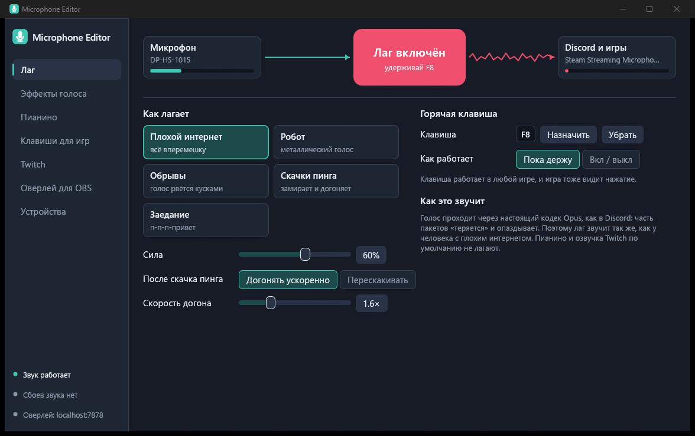
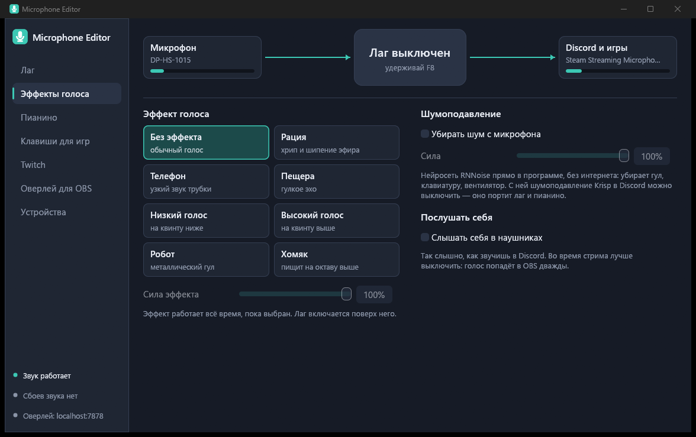
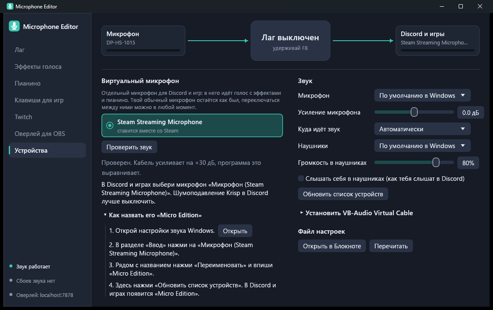
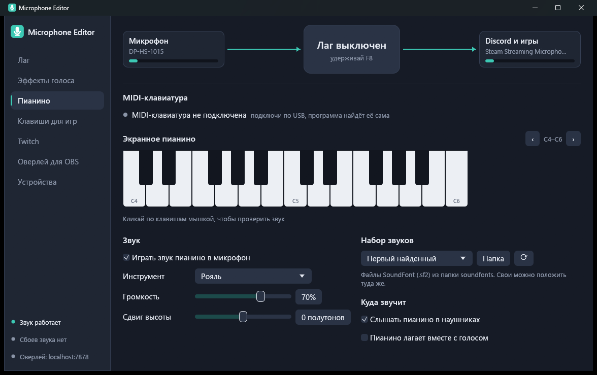
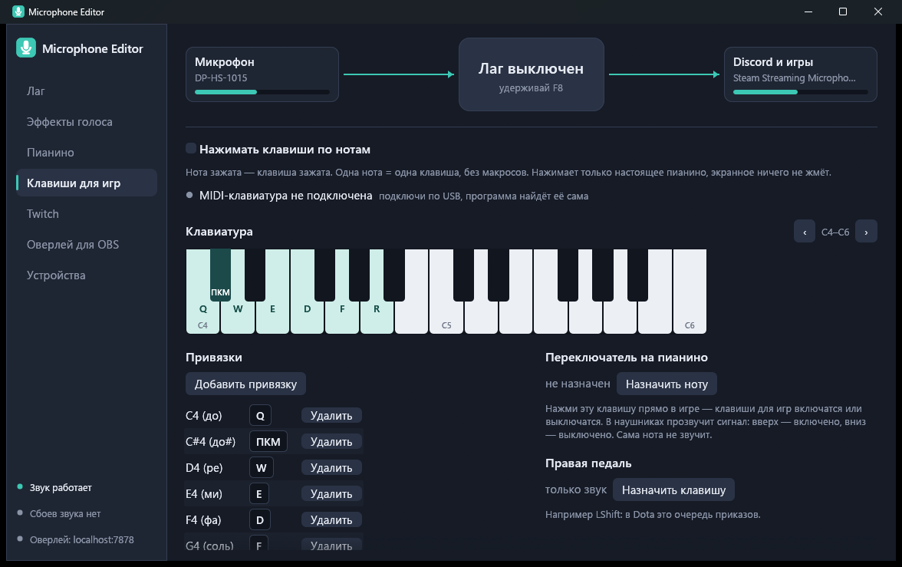
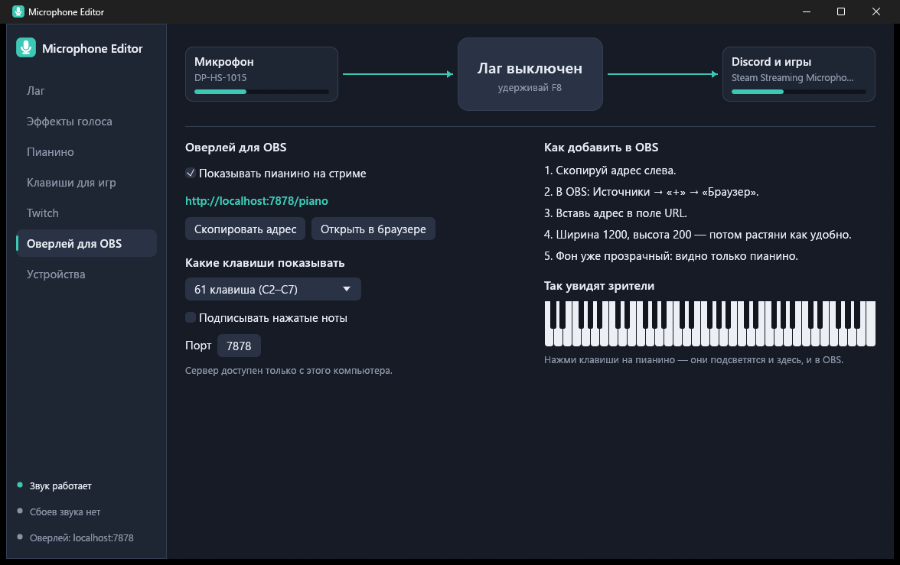
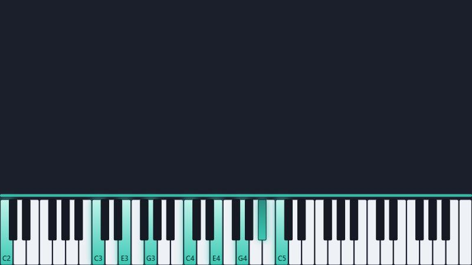
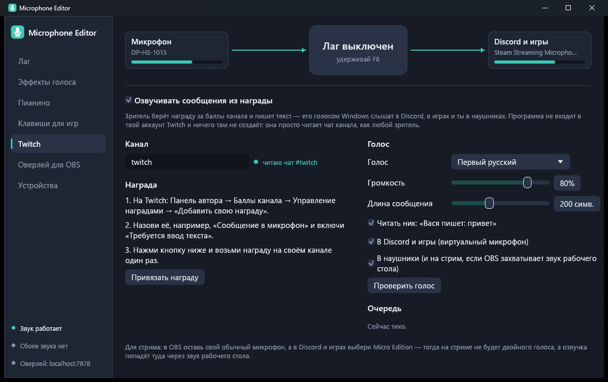

# Microphone Editor

Программа для Windows, которая делает отдельный микрофон **«Micro Edition»**
для Discord и игр. Через него можно:

- по кнопке «лагать» голосом, как человек с плохим интернетом;
- менять голос: рация, телефон, пещера, низкий, высокий, робот, хомяк;
- убирать шум с микрофона прямо в программе;
- играть на MIDI-пианино, чтобы его слышали в Discord и видели на стриме;
- озвучивать сообщения зрителей из награды за баллы канала на Twitch.

Твой обычный микрофон остаётся как был: в Discord и играх можно в любой
момент переключиться между ним и «Micro Edition».

<p align="center">
  
</p>

## Что умеет

| | |
|---|---|
| **Лаг голоса** | 5 режимов: робот, обрывы, скачки пинга, заедание и всё вперемешку. Звук проходит через настоящий кодек Opus, как в Discord, поэтому лаг звучит по-настоящему. Горячая клавиша работает в любой игре. |
| **Эффекты голоса** | Рация, телефон, пещера, низкий и высокий голос, робот, хомяк. |
| **Шумоподавление** | Нейросеть RNNoise прямо в программе: убирает гул и клавиатуру, Krisp в Discord больше не нужен. |
| **Micro Edition** | Отдельный микрофон в Windows. Программа сама находит виртуальный кабель, проверяет его и выравнивает громкость. |
| **Пианино** | MIDI-клавиатура звучит в микрофон. Ноты можно превратить в нажатия клавиш для игр, переключатель — прямо на пианино. |
| **Оверлей для OBS** | Зрители видят на стриме, какие клавиши пианино ты жмёшь. |
| **Twitch** | Зритель пишет текст в награде за баллы, голос Windows его зачитывает. Входить в аккаунт Twitch не нужно. |
| **Трей** | Программа живёт справа внизу у часов и не занимает панель задач. |

Окно широкое: слева вкладки и состояние (звук, сбои, пианино, оверлей), сверху
цепочка «Микрофон → Лаг → Discord и игры» с уровнями звука, ниже настройки
в две колонки.

## Быстрый старт

1. Запусти `microphone-editor.exe` (как собрать — в конце).
2. На вкладке **«Устройства»** выбери свой микрофон и виртуальный микрофон.
   Если стоит Steam, Steam Streaming Microphone найдётся сам.
3. Там же раскрой «Как назвать его «Micro Edition»» и переименуй его.
4. В Discord: *Настройки → Голос и видео → Устройство ввода* →
   **Micro Edition**. Там же выключи шумоподавление **Krisp**, иначе Discord
   «почистит» лаг и пианино.
5. Держи **F8** — голос лагает.

## Как идёт звук

```
                  ┌──────────────────── Microphone Editor ─────────────────────┐
Твой микрофон ───►│  шумодав → эффект → лаг (Opus)  +  пианино  +  озвучка     │───► Micro Edition ───► Discord, игры
                  │                                       │           │        │
                  │                                       └─────┬─────┘        │
                  └─────────────────────────────────────────────┼──────────────┘
                                                                ├──► наушники ───► OBS (звук рабочего стола)
                                                                └──► оверлей с пианино ───► OBS (источник «Браузер»)

OBS ◄─── твой обычный микрофон
```

Для стрима: в OBS оставь обычный микрофон, а в Discord и играх выбери
Micro Edition. Тогда на стриме не будет двойного голоса, а пианино и озвучка
попадут туда через наушники, то есть через звук рабочего стола. «Слышать себя
в наушниках» во время стрима лучше выключить, иначе твой голос тоже уйдёт в
звук рабочего стола.

## Лаг голоса

Discord передаёт голос кодеком Opus пакетами по 20 мс. Программа делает то же
самое: кодирует голос в настоящий Opus, «теряет» и задерживает часть пакетов,
а потом декодирует обратно. Поэтому роботный голос, обрывы и ускоренный
«догон» после скачка пинга звучат как у реально лагающего человека.

| Режим | Что слышно |
|---|---|
| Плохой интернет | всё вперемешку |
| Робот | потеря пакетов, металлический голос |
| Обрывы | голос пропадает кусками |
| Скачки пинга | голос замирает, потом догоняет ускоренно (или перескакивает) |
| Заедание | «п-п-п-привет» |

- **F8** по умолчанию: лагает, пока держишь. Клавишу можно сменить кнопкой
  «Назначить», подходят и боковые кнопки мыши.
- Режим «Вкл / выкл» включает лаг одним нажатием.
- Клавиша не «съедается»: игра тоже видит нажатие.

## Эффекты голоса и шумоподавление

<p align="center">
  
</p>

| Эффект | Как звучит |
|---|---|
| Рация | узкая полоса, хрип и шипение эфира |
| Телефон | узкий звук трубки |
| Пещера | гулкое эхо и реверберация |
| Низкий голос | на квинту ниже, без замедления |
| Высокий голос | на квинту выше |
| Робот | металлический гул (кольцевая модуляция) |
| Хомяк | почти на октаву выше |

Эффект работает, пока выбран, лаг включается поверх него. Пианино и озвучка
Twitch эффектами не обрабатываются.

**Шумоподавление** — нейросеть RNNoise прямо в программе, без интернета.
В тесте с шумом «вентилятора» шум в паузах стал тише на 21 дБ, а громкость
речи почти не изменилась. С ним шумоподавление Krisp в Discord можно
выключить: Krisp портит лаг и пианино.

Послушать эффекты без микрофона:

```bash
cargo run --release -- --fx-demo samples\original.wav samples\fx-hamster.wav hamster
```

## Виртуальный микрофон «Micro Edition»

<p align="center">
  
</p>

Обычная программа не может сама создать микрофон в Windows, это умеет только
звуковой драйвер. Поэтому нужен виртуальный кабель: что программа пишет в его
выход, то появляется в его микрофоне. Программа находит кабели сама:

- **Steam Streaming Microphone** уже есть, если установлен Steam. Он
  усиливает звук на +30 дБ, программа измеряет это и выравнивает громкость.
- **VB-Audio Virtual Cable** — бесплатный драйвер с vb-audio.com. Распакуй
  архив **целиком** в обычную папку (из архива установщик не сработает),
  правой кнопкой по `VBCABLE_Setup_x64.exe` → «Запуск от имени
  администратора» → **Install Driver**, перезагрузи компьютер.

Чтобы микрофон назывался «Micro Edition»: Параметры Windows → Система → Звук
→ в разделе «Ввод» нажми на микрофон кабеля → «Переименовать». Потом в
программе нажми «Обновить список устройств».

Если сделать Micro Edition микрофоном по умолчанию в Windows, программа не
начнёт слушать сама себя: она возьмёт настоящий микрофон и предупредит.

## Пианино

<p align="center">
  
  <br>
</p>

- Подключи MIDI-клавиатуру по USB: программа найдёт её сама, а если
  выдернешь — отпустит все клавиши.
- Звук играет синтезатор из файла SoundFont (`.sf2`) из папки `soundfonts`.
  Подойдёт бесплатный [GeneralUser GS](https://github.com/mrbumpy409/GeneralUser-GS):
  в нём рояль и ещё ~250 инструментов.
- На экранном пианино можно играть мышкой, ноты с настоящего пианино на нём
  подсвечиваются.
- **Клавиши для игр.** Включи «Нажимать клавиши по нотам», нажми «Добавить
  привязку», затем ноту и клавишу (или ЛКМ/ПКМ). Назначенные клавиши
  подписаны прямо на пианино. Правую педаль можно привязать, например, к
  `LShift` (очередь приказов в Dota). Одна нота — одна клавиша, без
  макросов. Нажимает только настоящее пианино.
- **Нота-переключатель.** Назначь клавишу пианино (например, самую правую)
  переключателем: нажатие на неё прямо в игре включает и выключает клавиши
  для игр. Выключено — пианино просто звучит в микрофон, включено — ещё и
  нажимает клавиши. В наушниках короткий сигнал: вверх — включено, вниз —
  выключено.

## Оверлей для OBS

<p align="center">
  
  <br>
  
</p>

Программа поднимает маленький веб-сервер, доступный только с этого
компьютера. Страница показывает пианино: нажатые клавиши светятся, педаль
горит полоской сверху, по желанию подписываются ноты. Фон прозрачный.

1. Вкладка «Оверлей для OBS» → «Скопировать адрес»
   (по умолчанию `http://localhost:7878/piano`).
2. В OBS: *Источники → «+» → Браузер*, вставь адрес в поле URL.
3. Ширина 1200, высота 200 — потом растяни как удобно.

Размер клавиатуры выбирается в программе (25–88 клавиш). Можно задать его и
прямо в адресе: `http://localhost:7878/piano?from=36&to=96`.

## Озвучка наград Twitch

<p align="center">
  
</p>

Программа **не входит в твой аккаунт** и ничего на Twitch не создаёт. Когда
зритель берёт награду с вводом текста, его сообщение приходит в обычный чат
с пометкой этой награды. Программа анонимно читает чат твоего канала, как
любой зритель, и озвучивает только сообщения из своей награды.

1. На Twitch: *Панель автора → Баллы канала → Управление наградами →
   Добавить свою награду*. Назови её, например, **«Сообщение в микрофон»** и
   включи **«Требуется ввод текста»**.
2. На вкладке «Twitch» включи озвучку и впиши свой канал.
3. Нажми **«Привязать награду»** и возьми награду на своём канале один раз.

Голос Windows (Ирина или Павел, работают без интернета) звучит в Micro
Edition и в наушниках. Ссылки заменяются словом «ссылка», длинные сообщения
обрезаются. Сообщение можно пропустить, очередь — очистить.

## Трей

Крестик и «Свернуть» прячут окно в трей, справа внизу у часов. Клик по значку
открывает окно, правый клик — меню: «Включить лаг» и «Выход». Когда лаг
включён, значок становится красным. Если запустить программу второй раз,
откроется уже работающая копия, а не вторая (иначе в микрофон шли бы два
голоса).

## Если программа упала

Любая ошибка записывается в `crash.log` рядом с программой: когда, в каком
потоке и где в коде. При следующем запуске окно покажет, что в прошлый раз
что-то сломалось, и предложит открыть журнал. Если синтезатор пианино
сломается во время игры, программа не закроется: замолчит только пианино,
а голос, лаг и озвучка продолжат работать.

## Настройки

Все настройки лежат в `config.toml` рядом с `.exe`, с комментариями на русском.
Окно сохраняет изменения само и не трогает комментарии. Файл можно править
Блокнотом (вкладка «Устройства» → «Открыть в Блокноте») и нажать
«Перечитать».

Числа, которые определяют, как звучит каждый режим лага, находятся в функции
`preset()` в `src/lag.rs`.

## Сборка и проверка

Нужны Rust и Visual Studio 2022 (C++), CMake берётся из Visual Studio.

```bash
cargo build --release
```

Готовая программа: `target\release\microphone-editor.exe`. Тесты: `cargo test`.

Команды для проверки без окна (`--help` покажет все):

| Команда | Что делает |
|---|---|
| `--render вход.wav выход.wav --mode robot` | прогнать WAV через эффект лага |
| `--piano-demo выход.wav` | сыграть мелодию синтезатором |
| `--fx-demo вход.wav выход.wav cave` | эффект голоса; `--add-noise --denoise` — проверить шумоподавление |
| `--say "текст" выход.wav --voice Pavel` | озвучить текст голосом Windows |
| `--loopback-test` | проверить виртуальные микрофоны и их усиление |
| `--twitch-watch канал1,канал2 60` | почитать чат и показать сообщения из наград |
| `--diagnose 20` | статистика звука: порции, паузы, обрывы |
| `--list-devices` | список звуковых устройств |

Например: `cargo run --release -- --loopback-test`.

## Планы

- [x] Лаг голоса через виртуальный микрофон
- [x] Звук пианино, экранное пианино
- [x] MIDI-клавиатура → клавиши для игр (нужна проверка на настоящем пианино)
- [x] Озвучка наград Twitch (нужна проверка на своём канале)
- [x] Трей и один запуск
- [x] Нота-переключатель «пианино ↔ клавиши для игр», журнал падений
- [x] Эффекты голоса и шумоподавление
- [x] Оверлей с пианино для OBS
- [x] Широкое окно: вкладки слева, настройки в две колонки
